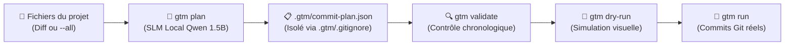

# Git Tasks-Time Machine (GTM)

[](LICENSE)
[](https://conventionalcommits.org)
[](https://github.com/conventional-changelog/commitlint)
[](https://ollama.com)
[](#sobri%C3%A9t%C3%A9-%C3%A9nerg%C3%A9tique--mode-local)
[-lightgrey.svg)](#pr%C3%A9requis--installation-des-d%C3%A9pendances-par-syst%C3%A8me)

**Git Tasks-Time Machine (GTM)** est un orchestrateur Git et planificateur de commits atomiques. Il permet de rejouer ou de reconstruire un historique de commits professionnel, cohérent et réaliste, soit à partir d'un fichier de plan JSON prédéfini, soit automatiquement via un modèle de langage compact local (**SLM Qwen2.5-Coder 1.5B** via Ollama).

Il **n'invente jamais de commits** : il inspecte en profondeur la sémantique de vos fichiers réels (endpoints HTTP, schémas XML, configurations, code source, pièces jointes) et applique fidèlement les règles d'or de **Conventional Commits v1.0.0**.

---

## 🧭 Sommaire

- [Pourquoi utiliser GTM ?](#-pourquoi-utiliser-gtm-)
- [Cycle de vie GTM (Workflow)](#-cycle-de-vie-gtm-workflow)
- [Prérequis & Installation des dépendances par système](#-pr%C3%A9requis--installation-des-d%C3%A9pendances-par-syst%C3%A8me)
- [Installation globale de GTM](#-installation-globale-de-gtm)
- [Démarrage rapide en 30 secondes](#-d%C3%A9marrage-rapide-en-30-secondes)
- [Guide des commandes](#-guide-des-commandes)
  - [`gtm doctor` (Diagnostic de l'environnement)](#1-gtm-doctor--diagnostic-de-lenvironnement)
  - [`gtm model` (Sélection & configuration du modèle SLM par défaut)](#2-gtm-model--s%C3%A9lection--configuration-du-mod%C3%A8le-slm-par-d%C3%A9faut)
  - [`gtm lang` (Configuration de la langue des commits)](#3-gtm-lang--configuration-de-la-langue-des-commits)
  - [`gtm plan` (Génération intelligente via SLM)](#4-gtm-plan--g%C3%A9n%C3%A9ration-intelligente-par-slm-local)
  - [`gtm validate` (Validation stricte & chronologique)](#5-gtm-validate--contr%C3%B4le-qualit%C3%A9--chronologique)
  - [`gtm dry-run` (Simulation visuelle transparente)](#6-gtm-dry-run--simulation-sans-toucher-%C3%A0-git)
  - [`gtm run` (Exécution réelle dans Git)](#7-gtm-run--application-chirurgicale-dans-git)
  - [`gtm test` (Suite de tests automatisés TDD)](#8-gtm-test--suite-de-tests-automatis%C3%A9s-tdd)
  - [`gtm update` (Mise à jour automatique)](#9-gtm-update--mise-%C3%A0-jour-du-programme)
- [Guide de sélection d'un SLM / LLM alternatif](#-guide-de-s%C3%A9lection-dun-slm--llm-alternatif)
- [Format du plan (`commit-plan.json`)](#-format-du-plan-commit-planjson)
- [Exemple réel de commit généré](#-exemple-r%C3%A9el-de-commit-g%C3%A9n%C3%A9r%C3%A9)
- [Agents IA & Intégration automatisée](#-agents-ia--int%C3%A9gration-automatis%C3%A9e)

---

## 💡 Pourquoi utiliser GTM ?

| Situation classique | Solution apportée par GTM |
| :--- | :--- |
| **Code en un seul bloc** : vous avez codé tout un projet d'un coup et vous avez 40 fichiers non commités. | `gtm plan` regroupe intelligemment les fichiers en modules atomiques cohérents. |
| **Messages de commit vagues** : `feat: add files` ou `update code`. | GTM extrait les endpoints, fonctions et schémas réels pour rédiger un sujet et une description technique obligatoire (`\n\n<body>`). |
| **Historique non chronologique ou dates incohérentes**. | GTM analyse les `mtime` réels des fichiers ou génère des timestamps synthétiques ordonnés en heures ouvrées. |
| **Peur de corrompre un dépôt**. | Mode `validate` strict et simulation `dry-run` avant toute écriture. |

---

## 🔄 Cycle de vie GTM (Workflow)



---

## 📦 Prérequis & Installation des dépendances par système

GTM nécessite **Git**, **Bash 3.2+**, **jq** (pour le parsing JSON), **Python 3.9+** et **Ollama** (pour la planification automatique).

### 🍏 macOS (Homebrew)
```bash
# 1. Installer les dépendances système (coreutils fournit gdate recommandé)
brew install git jq coreutils python ollama

# 2. Démarrer Ollama et télécharger le SLM sobre par défaut
brew services start ollama   # ou lancer l'application Ollama
ollama pull qwen2.5-coder:1.5b
```

> [!NOTE]
> **Cas de la commande `date` sous macOS** : Le `/bin/date` natif de macOS est BSD date. GTM s'y adapte automatiquement, mais l'installation de `coreutils` (qui fournit `gdate`) est vivement recommandée pour une précision optimale des conversions ISO 8601.

### 🐧 Linux — Ubuntu / Debian / Mint
```bash
# 1. Dépendances système
sudo apt update && sudo apt install -y git jq coreutils python3 curl

# 2. Installer et démarrer Ollama
curl -fsSL https://ollama.com/install.sh | sh
ollama pull qwen2.5-coder:1.5b
```

### 🐧 Linux — Fedora / RHEL
```bash
sudo dnf install -y git jq coreutils python3 curl
curl -fsSL https://ollama.com/install.sh | sh
ollama pull qwen2.5-coder:1.5b
```

### 🐧 Linux — Arch Linux
```bash
sudo pacman -S --noconfirm git jq coreutils python ollama
sudo systemctl enable --now ollama
ollama pull qwen2.5-coder:1.5b
```

### 🪟 Windows (via Git Bash & Winget)
Dans un terminal **PowerShell** (Administrateur) :
```powershell
winget install jqlang.jq Python.Python.3.12 Ollama.Ollama Git.Git
ollama pull qwen2.5-coder:1.5b
```
*(Git Bash fournit nativement Bash, Git et GNU `date`)*.

---

## 🚀 Installation globale de GTM

Le script s'installe **une seule fois** globalement sur votre machine :

```bash
# 1. Cloner le dépôt
git clone https://github.com/emerytossavi/Git_Tasks-Time_Machine.git ~/Git_Tasks-Time_Machine

# 2. Lancer l'installateur
bash ~/Git_Tasks-Time_Machine/install.sh
```

`install.sh` :
- Rend `gtm.sh` et les modules `lib/*.sh` exécutables.
- Crée un lien symbolique `gtm` dans `~/.local/bin` (ou `~/bin`).
- Détecte automatiquement votre shell (**`~/.zshrc`** sous macOS/zsh ou **`~/.bashrc`** sous Linux) et ajoute le dossier au `PATH` si nécessaire.
- Est **idempotent** : relançable sans risque à tout moment.

Ouvrez un nouveau terminal ou tapez `source ~/.zshrc` (ou `source ~/.bashrc`).

---

## ⚡ Démarrage rapide en 30 secondes

Placez-vous dans le dépôt de votre projet et lancez :

```bash
cd ~/mon-projet

# 0. Vérifier que votre environnement est prêt
gtm doctor

# 1. Générer automatiquement le plan de commits
gtm plan

# 2. Simuler visuellement l'exécution sans toucher à Git
gtm dry-run

# 3. Exécuter réellement les commits dans Git
gtm run
```

---

## 🛠️ Guide des commandes

### 1) `gtm doctor` — Diagnostic de l'environnement
Vérifie en un instant l'état complet de votre machine :
```bash
gtm doctor
```
Vérifie la présence et la version de :
- Shell Bash, Git CLI, `jq`
- Moteur de dates (`GNU date`, `gdate` ou `BSD date`)
- Python 3
- Démon Ollama en ligne (`http://localhost:11434`) et modèle SLM téléchargé
- Dépôt Git courant et présence éventuelle de `.gtm/commit-plan.json` (ou `commit-plan.json`)

---

### 2) `gtm model` — Sélection & configuration du modèle SLM par défaut
Permet de choisir interactivement parmi les modèles disponibles sur votre machine ou d'affecter un modèle par défaut stocké de manière persistante dans le fichier `config.env` :

```bash
# Menu interactif listant tous les modèles Ollama installés localement :
gtm model

# Lister les modèles et afficher le modèle actif :
gtm model --list

# Définir directement un modèle par défaut (sauvegardé dans config.env) :
gtm model qwen2.5-coder:7b
```

Le modèle sélectionné est automatiquement utilisé par `gtm plan` sans avoir à repréciser le drapeau `-m`.

---

### 3) `gtm lang` — Configuration de la langue des commits
Permet de définir ou de consulter la langue par défaut utilisée pour la rédaction des messages de commit (sujet et description technique). La langue est enregistrée de manière persistante dans `config.env` :

```bash
# Afficher la langue actuellement configurée (défaut : en) :
gtm lang

# Définir l'anglais comme langue par défaut (recommandé pour l'open-source) :
gtm lang en

# Définir le français comme langue par défaut :
gtm lang fr

# Alias disponible :
gtm config lang es
```

### 3b) `gtm timeout` — Configuration du délai d'inférence SLM
Gère le délai d'attente accordé aux requêtes d'inférence Ollama (défaut : `180` secondes) pour s'adapter aux machines à ressources modérées ou aux gros volumes de fichiers :

```bash
# Afficher le timeout actif :
gtm timeout

# Configurer un timeout personnalisé (ex: 240s ou 300s) :
gtm timeout 240
gtm config timeout 300
```

> [!IMPORTANT]
> **Universalité des types Conventional Commits** :  
> Quelle que soit la langue sélectionnée (`en`, `fr`, `es`, `de`, `it`, etc.), les **mots-clés de type (`feat`, `fix`, `docs`, `refactor`, `test`, `chore`, etc.) restent toujours en anglais standard** conformément à la spécification Conventional Commits v1.0.0. Seuls le résumé et le corps explicatif sont traduits et rédigés dans la langue choisie.
> De plus, GTM élimine automatiquement les scopes tautologiques (`test(test):` $\to$ `test:`, `docs(docs):` $\to$ `docs:`) et nettoie les numérotations brutes de titres markdown (`1. `, `2) `).

---

### 4) `gtm plan` — Génération intelligente par SLM local
Analyse l'arborescence, applique 100% des règles `.gitignore` natives du projet, extrait la sémantique technique réelle et fait appel au SLM local sobre configuré pour structurer un plan de commits atomiques.

```bash
gtm plan [options] [chemin/vers/plan.json]
```

#### Options :
- `-a`, `--all` : analyse l'ensemble des fichiers du projet (au lieu de se limiter aux modifications `git status`).
- `-l`, `--lang <code>` : force la langue des messages pour cette exécution (`en`, `fr`, `es`, `de`, `it`, `pt`, etc. - types standard toujours en anglais).
- `--dry-run` : affiche le plan généré dans le terminal sans créer de fichier sur le disque.
- `--date-strategy <last|first>` : stratégie de datation (`last` = date basée sur le dernier fichier modifié du lot [défaut], `first` = premier).
- `--start-date YYYY-MM-DDTHH:MM:SS` : impose une date de départ synthétique réaliste étalée sur des heures ouvrées (9h-18h30, hors week-ends).
- `-m`, `--model <nom>` : sélectionne un modèle Ollama alternatif (défaut: `qwen2.5-coder:1.5b`).

#### Exemples :
```bash
# Planifier uniquement les fichiers modifiés récemment
gtm plan

# Planifier l'ensemble d'un projet brut fraîchement importé
gtm plan -a

# Forcer la rédaction des messages en français
gtm plan -l fr

# Simuler la planification avec un modèle plus puissant
gtm plan -a --dry-run -m qwen2.5-coder:7b
```

---

### 5) `gtm validate` — Contrôle qualité & chronologique
Valide la structure du fichier de plan sans modifier Git :
```bash
gtm validate [chemin/vers/plan.json]
```
Contrôles stricts effectués :
- JSON syntaxiquement valide.
- Dates au format ISO 8601 strict.
- **Ordre chronologique strictement croissant** (garantit que l'historique Git n'a pas de retours en arrière anachroniques).
- Message de commit non vide.
- Tableau `files` non vide et **existence physique** de tous les fichiers ciblés (résolution des globs incluse).

---

### 6) `gtm dry-run` — Simulation sans toucher à Git
Affiche le déroulé exact de ce qui sera appliqué dans Git :
```bash
gtm dry-run [chemin/vers/plan.json]
```
Pour chaque commit :
- Numéro d'ordre et date programmée.
- Message complet (sujet Conventional Commits + description technique détaillée).
- Fichiers réellement ciblés après expansion des motifs glob.

---

### 7) `gtm run` — Application chirurgicale dans Git
Exécute chronologiquement les commits dans le dépôt courant :
```bash
gtm run [chemin/vers/plan.json]
```
Pour chaque entrée du plan :
1. `git reset` (nettoie l'index staging sans toucher à vos fichiers).
2. `git add -- <fichiers>` (indexe strictement les fichiers du commit).
3. Injecte le message complet via flux heredoc pour préserver fidèlement les sauts de ligne `\n\n`.
4. Applique la date avec synchronisation de `GIT_COMMITTER_DATE` et `git commit --date`.

---

### 8) `gtm test` — Suite de tests automatisés (TDD)
Exécute l'ensemble de la batterie de tests unitaires (Python standard library `unittest`) et des tests d'intégration en bac à sable Git isolé :
```bash
gtm test
```
- **Tests unitaires Python** : validation de la normalisation des en-têtes Conventional Commits, déduplication, réconciliation des orphelins, tri chronologique strict.
- **Tests d'intégration Shell** : validation de conformité des plans (`gtm validate`), simulation étanche (`gtm dry-run`), exécution réelle (`gtm run`), persistance de la configuration (`gtm model`, `gtm lang`).
- **Garantie zéro régression** : exécution rapide en quelques secondes, sans dépendance pip ou npm externe.

---

### 9) `gtm update` — Mise à jour du programme
Met à jour GTM directement depuis le dépôt officiel :
```bash
gtm update
# Alias disponibles :
gtm --update
gtm -update
gtm --u
gtm -u
```
- Si GTM a été cloné via Git : effectue un `git pull` fast-forward propre.
- Sinon : télécharge la dernière version stable via `curl` ou `wget`.

---

## 🧠 Guide de sélection d'un SLM / LLM alternatif

GTM utilise par défaut **Qwen2.5-Coder 1.5B**, choisi pour son **efficacité énergétique exemplaire** (tourne sur n'importe quel CPU en quelques secondes, consomme moins de 1 Go de RAM et se décharge immédiatement grâce à `keep_alive: 0`).

Vous pouvez changer ce modèle par défaut à tout moment de manière persistante avec `gtm model` (enregistré dans `config.env`), ou ponctuellement via `gtm plan -m <nom>`.

Si vous souhaitez utiliser un autre modèle via `gtm plan -m <nom>`, respectez ces **4 critères de compatibilité** :

1. **Capacité JSON Mode (`format: json`)** : Le modèle doit savoir générer du JSON strict sans bavardage textuel.
2. **Fine-tuning Code / Instruct** : Le modèle doit être spécialisé dans le code (`-coder` ou `-instruct`) pour comprendre les extensions, les diffs et les structures logiques.
3. **Contexte minimal de 4 096 tokens (8 192 recommandé)** : Indispensable pour traiter les modules multi-fichiers sans saturation.
4. **Dimensionnement matériel** :
   - *CPU ou RAM < 8 Go* : Modèles **≤ 3B** uniquement.
   - *GPU dédié ou Mac Apple Silicon (≥ 16 Go)* : Modèles **7B à 14B**.

### Modèles recommandés :
| Modèle Ollama | Poids | Recommandation | Cas d'usage |
| :--- | :--- | :--- | :--- |
| **`qwen2.5-coder:1.5b`** | **~1.0 Go** | ⭐ **Recommandé par défaut** | Léger, rapide, tourne partout (même sur PC bureautique). |
| **`qwen2.5-coder:7b`** | ~4.7 Go | ⭐⭐ **Excellente précision** | Idéal si vous disposez d'un GPU ou d'un Mac M-series. |
| **`deepseek-coder:1.3b`** | ~0.9 Go | Alternative légère | Très bonne adhérence au code source. |
| **`llama3.2:3b`** | ~2.0 Go | Généraliste compact | Polyvalent pour les dépôts à forte composante documentaire. |

---

## ⚙️ Configuration personnalisée (`config.env`)

Le fichier `config.env` situé à la racine de GTM vous permet de personnaliser l'environnement selon vos contraintes d'infrastructure ou de sécurité :

```bash
# Modèle SLM/LLM par défaut utilisé par 'gtm plan'
DEFAULT_MODEL="qwen2.5-coder:1.5b"

# Langue par défaut pour la rédaction des commits ('en', 'fr', 'es', 'de', 'it', 'pt', etc.)
# Note : les types Conventional Commits (feat, fix, docs...) restent toujours en anglais.
DEFAULT_LANG="en"

# Hôte / Serveur Ollama (défaut: http://localhost:11434)
# Permet de cibler une machine GPU dédiée sur le réseau local ou un port alternatif :
# OLLAMA_HOST="http://192.168.1.50:11434"
# OLLAMA_HOST="http://localhost:11435"
OLLAMA_HOST="http://localhost:11434"
```

> [!TIP]
> - **Changement de modèle ou de langue** : Utilisez `gtm model <nom>` et `gtm lang <code_langue>` pour mettre à jour automatiquement et proprement `config.env`.
> - **Serveur Ollama distant** : Si vous utilisez une instance Ollama sur le réseau local ou un port non standard, configurez `OLLAMA_HOST` dans `config.env` ou exportez `export OLLAMA_HOST="http://ip-serveur:port"`. GTM adaptera automatiquement les diagnostics (`gtm doctor`), les requêtes d'inférence (`gtm plan`) et la liste des modèles (`gtm model`).

---

## 📋 Format du plan (`.gtm/commit-plan.json`)

Le plan JSON décrit la séquence des commits à exécuter. Par défaut, il est généré dans `.gtm/commit-plan.json` et isolé par un fichier `.gtm/.gitignore` (`*`) pour ne laisser aucun résidu dans votre dépôt Git cible :

```json
{
  "commits": [
    {
      "date": "2026-10-16T09:15:00+01:00",
      "message": "feat(auth): implement Google OAuth registration flow\n\nAdd OAuth2 provider callback handler and user session initialization.\n\n- routes/auth.js: register /auth/google/callback endpoint\n- controllers/oauth.js: implement Google token exchange and user provisioning",
      "files": [
        "routes/auth.js",
        "controllers/oauth.js"
      ]
    }
  ]
}
```

### Règles de conformité :
- `date` : Timestamp ISO 8601 complet avec fuseau horaire (ex: `2026-10-16T14:30:00+01:00`).
- `message` : L'en-tête doit respecter le format `<type>(<scope>): <sujet>` en minuscules, suivi d'une ligne vide `\n\n` et d'une description technique détaillée.
- `files` : Chemins relatifs au dossier courant ou glob patterns (`src/**/*.ts`).

👉 Pour la spécification formelle complète et le schéma JSON Draft-07 / 2020-12, consultez **[docs/commit-plan-spec.md](docs/commit-plan-spec.md)**.

---

## 🔍 Exemple réel de commit généré

Voici un exemple concret de commit produit automatiquement par `gtm plan` sur une API d'entreprise :

```text
feat(formalites): implement writing formalities and registration requests

Implement POST /webServTiers/save endpoints in the formalites folder.

- 01-Creation-Personne-Morale.bru: POST /webServTiers/save - Formalité : Création d'entreprise (Personne Morale) - Processus : `ImmPMProcess`
- 02-Creation-Personne-Physique.bru: POST /webServTiers/save - Formalité : Création d'entreprise (Personne Physique) - Processus : `ImmPPProcess`
- 03-Modification-Entreprise.bru: POST /webServTiers/save - Formalité : Modification d'une entreprise - Processus : `ModifPMProcess`
- 04-Cessation-Activite.bru: POST /webServTiers/save - Formalité : Cessation d'activité - Processus : `ImmCessPMProcess`
- 05-Radiation-Entreprise.bru: POST /webServTiers/save - Formalité : Radiation d'une entreprise - Processus : `RadPMProcess`
- 06-Inscription-Surete.bru: POST /webServTiers/save - Formalité : Inscription d'une Sûreté Mobilière - Processus : `CrmSuretyProcess`
- folder.bru: folder order and metadata: 01-Formalites-Ecriture
```

---

## 🤖 Agents IA & Intégration automatisée

Si vous utilisez des agents d'intelligence artificielle (**Claude Code**, **Cursor**, **Copilot Workspace**, **Antigravity**, **Devin**) pour manipuler votre dépôt, consultez le guide dédié :

👉 **[AGENTS.md](AGENTS.md)** : Contrats d'interfaces non-interactifs, codes d'erreur, invariants de sécurité et directives d'automatisation.

---

## 📄 Licence

Ce projet est sous licence **MIT** — voir le fichier [LICENSE](LICENSE) pour plus de détails.
